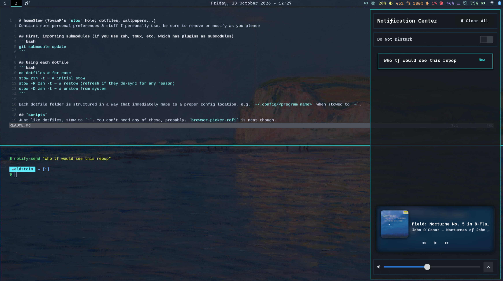

# homeStow (7ovanF's `stow` hole; dotfiles, wallpapers...)
Contains some personal preferences & stuff I personally use, be sure to remove or modify as you please



> If these dotfiles contain assets I haven't credited yet (I definitely copied some things blindly early on) let me know

## First, importing submodules (if you use zsh, tmux, etc. which has plugins as submodules)
```bash
git submodule update
```

## Using each dotfile
```bash
cd dotfiles # for ease
stow zsh -t ~ # initial stow
stow -R zsh -t ~ # restow (refresh if they de-sync for any reason)
stow -D zsh -t ~ # unstow from system
```

Each dotfile folder is structured in a way that immediately maps to a proper config location, e.g. `~/.config/<program name>` when stowed to `~`.

#### Sway wallpaper
The file `dotfiles/sway/.config/sway/config.d/99-wallpaper.conf` has been added to the `.gitignore`. Just add the following to set the wallpaper:
```
output * background '${HOME}/Pictures/Wallpapers/sisley-villagelake.webp' stretch
```

## `scripts`
Just like dotfiles, stow to `~`. You don't need any of these, probably. `browser-picker-rofi` is neat though.

## `home`
Yeah, just contains my wallpapers and misc work. I personally only stow the Wallpaper folder instead of the Pictures folder (need manual `-t` to `~/Pictures`)

## `rices`
Not stowed, just copied to appropriate spots.
